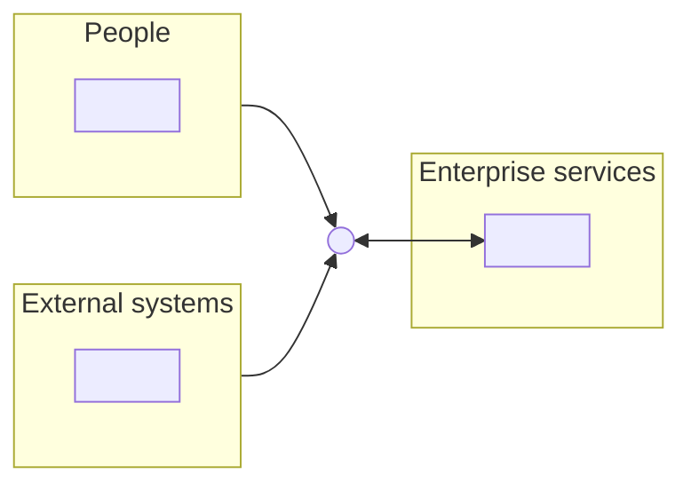
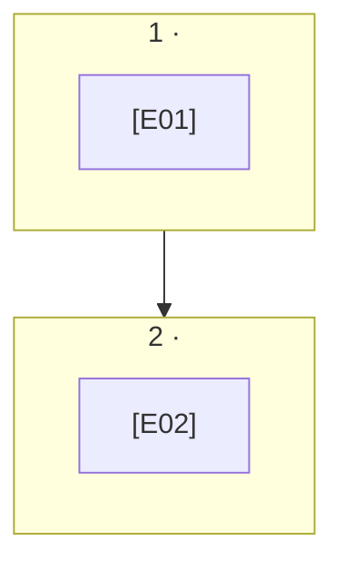
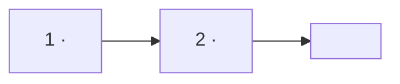
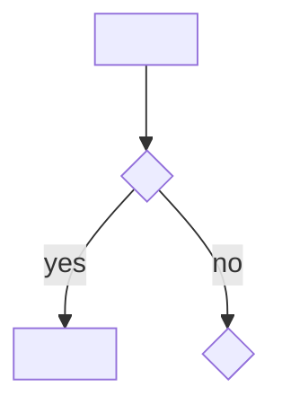
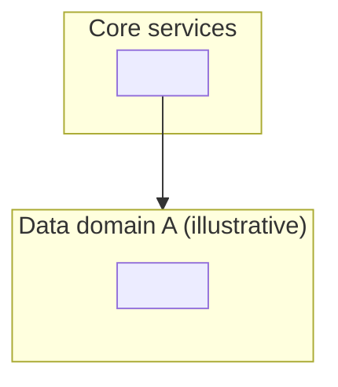
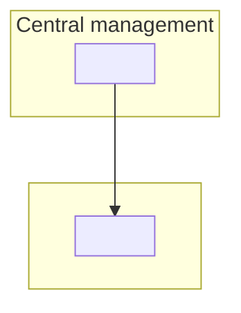

# <Initiative> – Solution Architecture Overview

Status: Draft v0.1 – target architecture for review. Source: <vision file> (<vision status/version>)<, epic or feature list>. Technology examples are illustrative and *(to be validated)*; the architecture is technology-neutral.

## Change History

| Version | Date | Change | Approved by |
|---|---|---|---|
| v0.1 | <YYYY-MM-DD> | Initial draft | – |

<!--
TEMPLATE NOTES (delete when filling in)
- Keep only the sections for views the user approved. Sections 0, 0.1, 1, 2, 3, 8, 9, 11 and 12 are always present. Section 10 (Transition) only if something is replaced.
- Every principle, block and decision must trace to a driver from the source. Mark your own judgements with "(judgement – please confirm)".
- Mermaid: use flowchart TB/LR; quote labels with special characters; keep node IDs short (e.g. GW, IAM, DB).
- Do not mention topics the user excluded.
-->

## 0. Architecture Drivers

| # | Driver | Source section | Type |
|---|---|---|---|
| D1 | <Driver description> | <vision §x> | Regulation / Quality goal / Constraint / Capability |

## 0.1 Quality Goals (measurable)

Top 3–5 goals. Targets stay TBD unless the source gives numbers.

| # | Quality attribute | Scenario (condition → expected response) | Measure / target | Driver |
|---|---|---|---|---|
| Q1 | <Quality attribute> | <Condition → expected response> | TBD | <D1> |

## 1. Architecture Principles

| # | Principle | Why (driver) |
|---|---|---|
| P1 | **<Short name>** – <what it means in one sentence>. | <driver(s) it serves> |

## 2. System Context

<One sentence: who and what interacts with the initiative.>

## 3. Logical Architecture

<One sentence: number of layers and how to read them.>

### 3.1 Building blocks

| Layer | Building block | Responsibility | Key controls / quality attributes | Epics |
|---|---|---|---|---|
| <Layer> | <Block> | <What it does> | <Controls> | <E01> |

## 4. <Key Flow> (optional)

| Step | Control applied |
|---|---|
| 1 · <Step> | <Control> |

### 4.1 <Critical scenario> (optional)

## 5. <Data & Integration> (optional)

| Data domain | What it holds | Integration / access |
|---|---|---|
| <Domain A> | <...> | <...> |

## 6. <Deployment Topology> (optional)

- <Note on what stays inside an environment / what flows between environments.>

## 7. Traceability (optional)

| Requirement (source) | Architecture response | Related building blocks |
|---|---|---|
| <Requirement> | <How the architecture answers it> | <Block, Block> |

## 8. Key Architecture Decisions (to be validated)

| # | Decision | Status (proposed / accepted / superseded) | Context | Rationale | Alternatives considered | Consequences / trade-offs |
|---|---|---|---|---|---|---|
| AD1 | <Decision> | <proposed> | <Situation and forces> | <Why> | <Alternative – why not> | <Consequence / trade-off> |

## 9. Risks & Technical Debt

| # | Risk or debt | Impact | Likelihood | Mitigation | Related blocks |
|---|---|---|---|---|---|
| R1 | <Risk or debt> | <Impact> | <Low / Medium / High> | <Mitigation> | <Block, Block> |

## 10. Transition (current → target) (only if something is replaced)

As-is summary: <what exists today>.

| Phase | State | What changes | Coexistence |
|---|---|---|---|
| <Phase 1> | <Interim state> | <What changes> | <What runs in parallel> |

Migration notes: <data, cut-over, rollback>.

## 11. Open Architecture Questions

1. <Question that blocks sizing, technology choice or a decision>

## 12. Out of Scope

- <Topics the user excluded – listed so they are not reintroduced>
