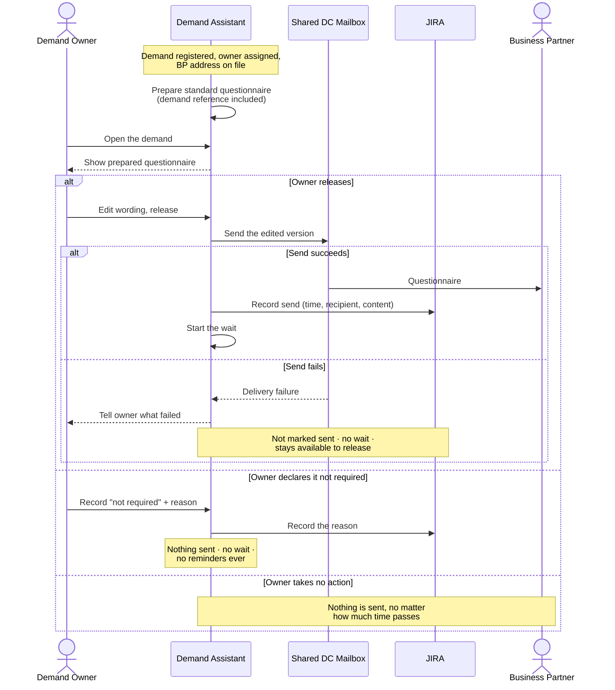

# STORY: Release the prepared questionnaire to the Business Partner

**Story ID**: STORY-DC-2026-002-01
**Epic**: EPIC-DC-2026-002 — Questionnaire Without Chasing
**Card / Step**: S-07 / T-04 *(story-map.md)*
**Domain**: DC Flow — Requirements (Questionnaire)
**Persona**: Demand Owner (P-01)
**Created Date**: 2026-11-16
**Priority**: High (MVP)
**Status**: Draft
**Estimate**: TBD

> Sources: `dc/artifacts/epics/questionnaire-without-chasing-epic.md` (AC1, AC2, AC9, AC10), `dc/artifacts/epics/questionnaire-without-chasing-functional-spec.md` (§4.1, §4.2, E1–E3, E9), `dc/context/business-context.md` (§7 business rules).
> *(to be validated)* = assumption not yet confirmed. *(TBD)* = value or decision not yet available.

---

## 1. Business Context

Every demand begins with the same exchange: the Demand Owner sends the standard questionnaire to the Business Partner, then waits. Today the owner writes that email by hand from their own or the shared DC mailbox — roughly 20–30 minutes per demand — and then types the send into JIRA later, if at all. Because the wording and tone depend on whoever owns the demand, Business Partners get an uneven first impression of LoDA, and because the JIRA write is manual and often skipped, LoDA cannot prove when the questionnaire actually went out.

This is the first wait of every demand and therefore the first place where LoDA's 25–30 days of held time starts accruing. It is also the step that must exist before anything else in this epic can work: there is no wait to track, no reminder to prepare and no reply to match until the questionnaire has been released and the send recorded.

The questionnaire itself is standard, agreed content, so there is no judgement in writing it — only in deciding that this demand is ready for it and that this Business Partner is the right recipient. That decision stays with the Demand Owner. The product's governing rule applies without exception: the assistant prepares the evidence, a named person decides. Nothing reaches the Business Partner on a timer, and the Business Partner must not be able to tell whether a person or the assistant composed the message.

**Value**: converts a 20–30 minute writing task into a review-and-release action of about 5 minutes, makes the questionnaire wording consistent across all Demand Owners, and produces the first reliable JIRA timestamp in the demand's life — the anchor every later measurement in this epic depends on.

---

## 2. Story Text

> **As a** Demand Owner,
> **I want to** review the already-prepared standard questionnaire and release it to the Business Partner with one action,
> **so that** the demand's first wait starts the same day I look at it, with wording consistent across the team and the send recorded in JIRA.

---

## 3. Acceptance Criteria

### AC1 — The questionnaire is ready and waiting

**Given** a demand is registered in JIRA with a Demand Owner assigned and a Business Partner address on file
**When** the Demand Owner opens the demand
**Then** the standard questionnaire is already prepared and addressed to that Business Partner
**And** it carries the demand reference so a later reply can be matched to this demand

### AC2 — Nothing is sent without release

**Given** a prepared questionnaire that the Demand Owner has not released
**When** any amount of time passes
**Then** nothing is sent to the Business Partner
**And** no wait begins

### AC3 — Release sends and records

**Given** a prepared questionnaire
**When** the Demand Owner edits the wording and releases it
**Then** the edited version — not the original draft — is sent to the Business Partner
**And** the send is recorded on the demand's JIRA ticket with the time, the recipient and the content that was sent
**And** the wait begins from the moment of the successful send

### AC4 — The questionnaire can be declared unnecessary

**Given** the Business Partner has already supplied the information another way
**When** the Demand Owner records that the questionnaire is not required, giving a reason
**Then** nothing is sent to the Business Partner
**And** the reason is recorded on the JIRA ticket
**And** no wait begins and no reminder is ever prepared for this demand

### AC5 — A failed send is never recorded as sent

**Given** the Demand Owner has released the questionnaire
**When** the message cannot be delivered — for example the address is invalid or the mailbox is unavailable
**Then** the Demand Owner is told immediately, with what failed
**And** the demand is not marked as sent and no wait begins
**And** the questionnaire stays available to release again once the problem is fixed

### AC6 — Preparation is blocked, visibly, when prerequisites are missing

**Given** a registered demand with no Business Partner address, or with no Demand Owner yet assigned
**When** the questionnaire would otherwise be prepared
**Then** it is not prepared
**And** the Demand Owner is told specifically what is missing
**And** preparation happens automatically once the missing detail is supplied, with no further action needed

### AC7 — The Business Partner cannot tell it was machine-prepared

**Given** a questionnaire prepared for a Business Partner
**When** it is shown to the Demand Owner or sent
**Then** it contains no label, footer, disclaimer, signature block or subject-line marker identifying the assistant
**And** no unfilled placeholder from the template remains in the text
**And** no sender or reply-to address other than the shared DC mailbox appears
**And** in a blind review, Demand Owners cannot distinguish prepared questionnaires from human-written ones at better than chance *(review method and sample size to be validated)*

### AC8 — Personal data is masked and never leaves the local model

**Given** a questionnaire being prepared, containing the Business Partner's name and email address
**When** the content is processed by AI
**Then** personal data is masked before it reaches the model
**And** only the local model is used
**And** the record of the preparation shows no external AI route was called

### AC9 — The send attempt is auditable, not just recorded

**Given** the Demand Owner releases the questionnaire
**When** the send is attempted, whether it succeeds or fails
**Then** a durable record captures who released it, when, the recipient, the outcome, and the attempt
**And** that record survives independently of the business-facing JIRA entry
**And** a failed attempt is recorded as a failure, never as a send

### AC10 — The questionnaire is waiting, not being written

**Given** a demand that meets the prerequisites in AC1
**When** the Demand Owner opens it for the first time
**Then** the prepared questionnaire is already there to review
**And** the Demand Owner is never shown a pending or in-progress state while it is generated
**And** preparation begins when the demand becomes eligible, not when the demand is opened

---

## 4. Out of Scope

- Preparing, releasing or dismissing **reminders** once the wait has begun — separate story (card S-08)
- The **long-wait alert** to the Demand Owner and LoDA Manager — separate story (card S-09)
- **Detecting and filing the reply** in JIRA, including unmatched and out-of-office replies — separate story (card S-10)
- **Merging answers and flagging gaps** as answered / missing / vague / not stated — Release 2 (card S-11)
- Drafting the **consolidated follow-up** after gaps are found
- The LoDA Manager's **waiting overview**
- **Changing the content of the standard questionnaire** — the team's existing template is used as-is
- **Pausing or resuming a wait** — flagged *(to be validated)* in the functional spec, not yet a committed capability

---

## 5. Dependencies

| Dependency | Type | Status |
|---|---|---|
| A demand registered in JIRA with a Demand Owner assigned and a Business Partner address | Upstream story (intake) | Open |
| The team's approved standard questionnaire template | Team — Demand Owner | Open |
| Send access to the shared DC mailbox | System / IT | Open — see Assumption A1 |
| The demand's JIRA ticket as the place the send is recorded | System | Available — JIRA is already the system of record |
| Local model availability for preparation with masking | System / InfoSec | Open — gates AC8 |
| Wait tracking must begin on successful send | Downstream (cards S-08, S-09) consume this story's output | — |

---

## 6. Assumptions

| # | Assumption | Status |
|---|---|---|
| A1 | On release, the assistant sends from the shared DC mailbox directly, rather than handing the Demand Owner text to copy into their own mail client | *(assumed — to be validated with IT; Epic Open Question 3)* |
| A2 | Release is required for the questionnaire even though it is pre-approved content | **Contested — see Open Question 1** |
| A3 | The demand reference travels in the message in a form that survives a normal reply | *(assumed — to be validated; see Open Question 3)* |
| A4 | "Release" is a single action on the demand, not a multi-step confirmation flow | *(assumed — to be validated with Demand Owners)* |
| A5 | If the Demand Owner edits the wording, the edit applies to this demand only and does not change the team's template | *(assumed — to be validated)* |
| A6 | A demand has exactly one Business Partner address for the questionnaire; multiple recipients are not in this story | *(assumed — to be validated)* |

---

## 7. Supporting Diagram

---

## 8. Non-Functional Requirements

Per the decision taken during refinement, all identified NFRs are handled as acceptance criteria in this story rather than as separate NFR stories:

| NFR | Covered by |
|---|---|
| Local-model-only processing, personal data masked | AC8 |
| No machine-prepared signal towards the Business Partner | AC7 |
| Auditability of the send attempt and its authorisation | AC9 |
| Draft availability — prepared before the owner opens the demand | AC10 |

**Consequence**: AC8 makes this story InfoSec-gated. The epic only scheduled the InfoSec check at Test Case 11, so this story cannot be accepted until that check is available for an MVP-priority item.

---

## 9. Open Questions

1. **Does the pre-approved questionnaire actually require release?** `business-context.md` §7 exempts "the pre-approved questionnaire template and standard reminders" from human approval, while EPIC-DC-2026-002 AC2 requires release for everything. This story is written the epic's way (release mandatory). If the exemption stands, AC2 and AC3 are wrong and the story becomes "auto-send on preparation" — a materially different story. *(Epic Open Question 4 — unresolved)*
2. Can the assistant send from the shared DC mailbox, or does the Demand Owner copy the text out? *(Epic Open Question 3 — changes this story's size materially)*
3. **AC1 and AC7 collide.** AC1 requires a demand reference so the reply can be matched; AC7 forbids any marker that reads as machine-generated. If the reference is a visible subject-line token, both cannot hold. How the reference travels must be decided before this story is accepted — this is a blocker, not a detail.
4. What happens if the Demand Owner edits the wording so heavily it no longer matches the approved template — is there a boundary, or is the owner trusted absolutely?
5. Persona naming: this story says **LoDA Manager** per EPIC-DC-2026-002, but `E-MVP-02-questionnaire.md` and `story-map.md` call P-02 the **Demand Manager**. Which is correct? *(Does not affect this story's ACs; will affect card S-09.)*

---

*End of Story Document*
